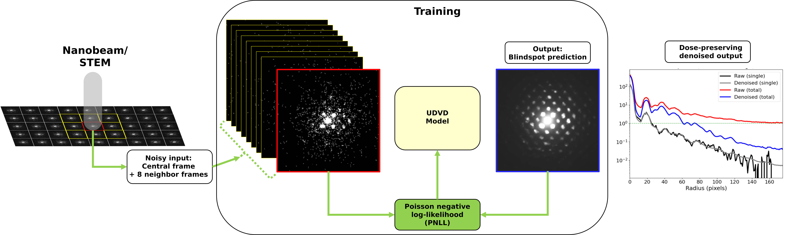

<p align="left">
  <a href="https://opensource.org/licenses/MIT">
    
  </a>
  
  
  
  <a href="https://github.com/ashriva16/4Denoising/issues">
    
  </a>
  <a href="https://github.com/ashriva16/4Denoising/pulls">
    
  </a>
</p>

# Unsupervised Deep Denoising for High-Dimensional Microscopy Data

**Authors:**
Leonardo Cancellara¹ · William Talbott² · Ankit Shrivastava³ · Jordi Weingard² · Dingqiao Ji¹ · Ian MacLaren⁴

¹ Max Planck Institute of Colloids and Interfaces
² University of Manchester
³ Oak Ridge National Laboratory
⁴ School of Physics and Astronomy, University of Glasgow, UK

## 📌 Description

This repository implements an unsupervised deep-learning framework for denoising high-dimensional microscopy data, with a primary focus on 4D-STEM.
The approach is based on UDVD (Unsupervised Deep Video Denoising), a UNet-based convolutional neural network that exploits structural similarity between neighboring frames without requiring any ground-truth clean data.

Originally developed for time-series video denoising, UDVD is generalized here to multidimensional microscopy datasets by replacing temporal adjacency with geometric-flow connectivity in real space, and the MSE loss function with the Poisson NLL. This enables denoising of sparse diffraction patterns with high dynamic range, using spatially adjacent scan positions to predict pixel-wise intensities via a blindspot algorithm.



---

## 📁 Repository Setup

```sh
git clone https://github.com/ashriva16/4Denoising.git
cd 4Denoising
```

---

## 🚀 End-User Setup & Usage

- **Use the Makefile to create a .venv and install user-level dependencies.**

    ```bash
    make env
    ```

    This creates `.venv/` and installs packages from `requirements.txt` (if present).

- **For refreshing and installing updated dependencies, run**

    ```bash
    git pull        # get latest code + updated requirements.txt
    make install    # refresh dependencies inside .venv #UPDATE DEPENDENCIES!
    ```

- **Usage**

    ```sh
    source .venv/bin/activate
    python -m scripts.train --config configs/config.yml # to train model from scratch
    python -m scripts.infer --config configs/config.yml --checkpoint checkpoints\TiO2\002\blind-video-net-5d-cross\run0\checkpoint_50.pth --output results/denoised.h5 # to denoise with a trained model
    python -m scripts.infer --config configs/config_sources.yml --checkpoint <ckpt> --source all --output results/ # every dataset, one .h5 each
    # NEEDS TO BE REWRITTEN python -m scripts.run_pretrain # to run pretrained UDVD model, see references
    python -m scripts.train --config configs/config.yml --weights path/to/checkpoint.pth # start from trained weights (fine-tuning; same as scripts.fine_tune)
    python -m scripts.train --config configs/config.yml --resume path/to/checkpoint_10.pth # continue an interrupted run
    ```

---

## 📂 Input formats

`core.readers` puts one small interface in front of every file format, and
`core.stream` does the rest (dead-pixel correction at full detector size, crop,
detector and scan binning) row by row, so full-size scans never have to fit in RAM.

| `fmt` | Data | Notes |
|---|---|---|
| `arina` | DECTRIS ARINA `*_master.h5` | streamed; needs `hdf5plugin`; pass `scan_shape` |
| `h5` | a 4D dataset in any HDF5 file (FPD, py4DSTEM, ...) | `key=` if ambiguous; `index=` for a 5D stack |
| `npy` | `.npy` | memory-mapped |
| `rsciio:<plugin>` | anything [RosettaSciIO](https://hyperspy.org/rosettasciio/supported_formats/index.html) reads, e.g. `rsciio:quantumdetector` (Merlin `.mib`) | `pip install ".[formats]"`; lazy where the plugin supports it |

```python
from core.stream import load_dataset
data, info = load_dataset("scan_master.h5", scan_shape=(500, 1000), q_bin=2, r_bin=1)
```

`fmt="auto"` (default) chooses from the extension and file layout. `info` records
the reader and every setting, for provenance. A new format is one function
decorated with `@register_reader("name", extensions=(".ext",))` in `core/readers.py`.

**Several datasets at once.** List them under `dataset.sources` (see
`configs/config_sources.yml`): they are pooled into one training set, each keeps
its own neighbour geometry, and `dataset.scan_mask` selects which scan positions
are training targets (e.g. a checkerboard half for a leave-one-region-out test).
`scripts.infer --source <index|label>` denoises one of them with exactly the
same preprocessing. Configs with `data_dir` + `file` work as before.

**Detector defects.** `python -m scripts.make_defect_mask --config <cfg> --plot mask.png`
builds the dead/hot-pixel mask once, at full detector size, from a reference
region (detectors and their parameters in the `defects` section), and saves it
with its provenance. With `dataset.defect_mask_file` set, every dataset is
inpainted with that same mask while it is read, before any binning.

**Weights and provenance.** Training starts from scratch, from given weights
(`--weights` or `model.weights`; fresh optimizer, optional `train.trainable` to
fine-tune only some layers), or resumes a run (`--resume`). Every checkpoint
stores a `provenance` record: data sources, crops, binning, offset, defect-mask
digest, where the starting weights came from, code version and git commit,
software versions and GPU. `scripts.train --weights` and `scripts.infer` compare
the weights' recorded binning and offset with the data. `--domain-policy`
(or `dataset.domain_policy`) decides what a mismatch does: `strict` (default)
stops, `warn` and `off` run and record every difference (key, training value,
data value) in the provenance of the result, so cross-domain experiments, e.g.
other binning or camera length, are always labelled as such.

**Inference at scale.** `scripts.infer` reads each dataset in blocks of scan rows
and denoises them in GPU batches, with the neighbour frames gathered on the GPU,
so memory is bounded by the block rather than the dataset and full-size scans
run on a laptop. The output is identical to position-by-position denoising
(tested). `.h5` output holds `data` (float16 by default), `intensity_image`,
`mean_pattern` and the full provenance as an attribute, and is resumable: an
interrupted run continues where it stopped. `--source all` writes one file per
dataset. Tuning: `--batch-size` (halved automatically on GPU out-of-memory),
`--block-rows`, `--amp` (mixed precision, faster, not bit-identical).

**Container.** `Dockerfile` builds one image for workstations (Docker) and HPC
clusters (Apptainer); see [docs/container.md](docs/container.md).


---

## 👤 Maintainer

**Ankit Shrivastava**
Feel free to contact me for issues.

---

## 🛠️ Development

Contributor setup, tests, and packaging notes are in [development.md](development.md).

---

## 📜 License

This project is licensed under the [MIT License](https://opensource.org/licenses/MIT). See the `LICENSE` file for full details.

---

## 📘 References

- https://github.com/crozier-del/UDVD-MF-Denoising/tree/v1.0?tab=readme-ov-file
- https://github.com/sreyas-mohan/udvd
